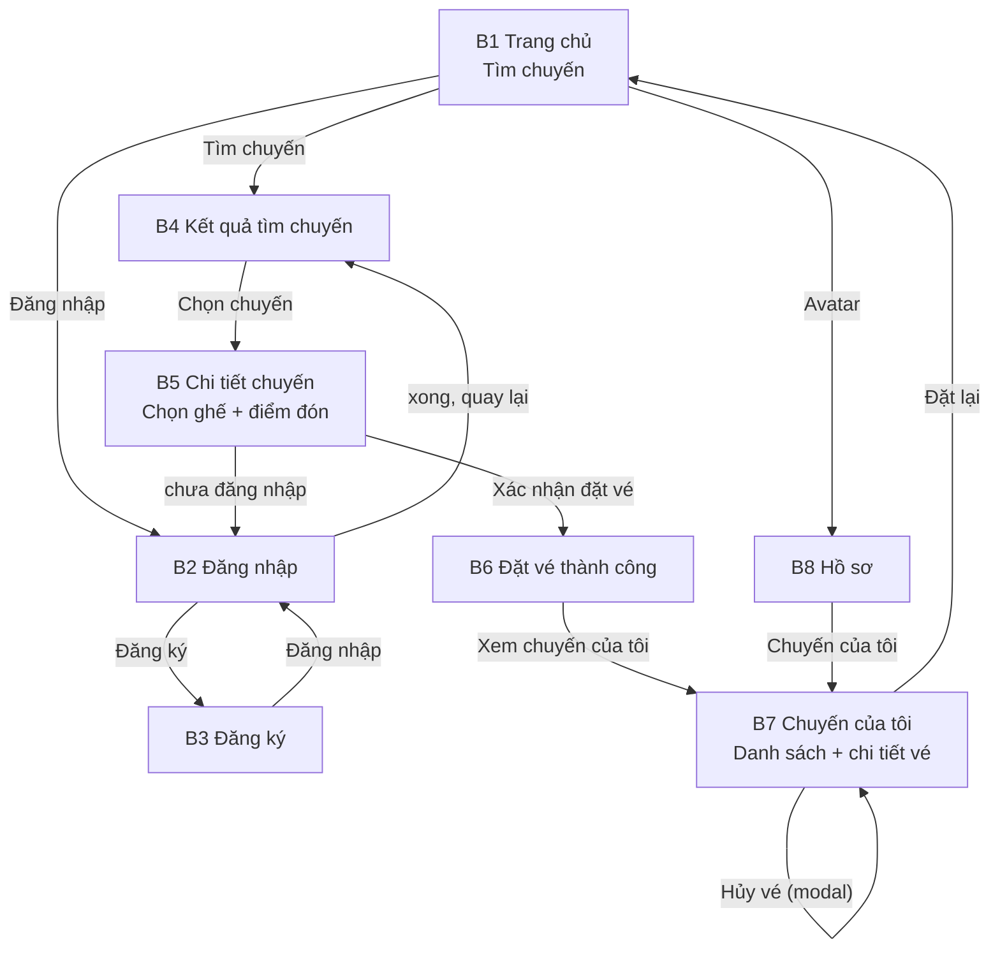

# 01 — MÀN HÌNH KHÁCH HÀNG (8 MÀN)

> Vai trò: **Khách hàng** — người tìm và đặt ghế trên chuyến xe ghép liên tỉnh.
> Shell: **M** cho trang chủ, **Auth** cho đăng nhập/đăng ký, **U** cho khu đã
> đăng nhập.
>
> **Mô hình:** admin tạo chuyến và mở bán ghế; khách chọn chuyến có sẵn, chọn
> ghế/điểm đón rồi đặt vé. Hệ thống **tự xác nhận** đơn hợp lệ — không có bước
> admin ghép tài xế vào đơn.
>
> **Thanh toán MVP:** tiền mặt cho tài xế khi lên xe. Trạng thái thanh toán chỉ
> gồm `Chưa thu / Đã thu`. **Không có hoàn tiền**: khách chỉ trả khi lên xe nên vé
> hủy trước khi thu tiền không phát sinh khoản hoàn.
>
> **Đã bỏ khỏi phạm vi:** đổi vé, đánh giá, ưu đãi, thông báo, trợ giúp, ticket,
> chat, FAQ, hotline, hoàn tiền. Hủy vé là nút trong **chi tiết vé**, không có màn
> riêng.

---

## 1. Danh sách màn

| Mã | Màn hình | Thư mục | Shell | Chức năng |
|----|----------|---------|-------|-----------|
| B1 | Trang chủ | `home` | M | Giới thiệu ngắn + form tìm chuyến |
| B2 | Đăng nhập | `dang-nhap` | Auth | Xác thực khách hàng |
| B3 | Đăng ký | `dang-ky` | Auth | Tạo tài khoản khách |
| B4 | Kết quả tìm chuyến | `ket-qua-tim-chuyen` | U | Danh sách chuyến phù hợp |
| B5 | Chi tiết chuyến | `chi-tiet-chuyen` | U | Chọn ghế, điểm đón/trả, đặt vé |
| B6 | Đặt vé thành công | `dat-cho-thanh-cong` | U | Hiển thị thông tin vé |
| B7 | Chuyến của tôi | `chuyen-cua-toi` | U | Danh sách vé + chi tiết vé + hủy |
| B8 | Hồ sơ | `ho-so` | U | Quản lý thông tin cá nhân |

---

## 2. Chi tiết từng màn

### B1. Trang chủ — `screens/home/`

- **Tác dụng:** điểm vào công khai, giúp khách tìm chuyến trong một thao tác.
- **Nhiệm vụ chính:**
  - Hero + form tìm chuyến: điểm đi, điểm đến, ngày, số ghế (`#dat-xe`).
  - Danh sách tuyến phổ biến (điền sẵn form khi bấm).
  - Giới thiệu ngắn 3 bước: chọn chuyến → chọn ghế → lên xe trả tiền mặt.
  - CTA "Tìm chuyến" → B4; liên kết đăng nhập/đăng ký.
- **Thành phần:** `site-header`, `.booking-form`, `.route-card`, `.feature-card`,
  `site-footer`.
- **Trạng thái:** form lỗi validate, đang tìm (loading ngắn).
- **Đã bỏ:** FAQ, hotline, khối đánh giá/testimonial, khối "Dành cho tài xế"
  (tài xế không tự đăng ký), banner khuyến mãi.
- **Ưu tiên:** P0.

### B2. Đăng nhập — `screens/dang-nhap/`

- **Tác dụng:** xác thực khách hàng trước khi đặt vé.
- **Nhiệm vụ chính:**
  - Nhập SĐT/email + mật khẩu; ghi nhớ đăng nhập.
  - Liên kết sang đăng ký.
  - Đăng nhập thành công → quay lại trang trước đó (hoặc B1).
- **Thành phần:** panel form, `.field`, `.btn.is-loading`, `.form-status`.
- **Trạng thái:** sai thông tin, tài khoản bị khóa, loading.
- **Không có:** đăng nhập mạng xã hội, quên mật khẩu (không nằm trong 8 màn).
- **Ưu tiên:** P0.

### B3. Đăng ký — `screens/dang-ky/`

- **Tác dụng:** tạo tài khoản khách hàng mới.
- **Nhiệm vụ chính:**
  - Họ tên, SĐT, email, mật khẩu + xác nhận, đồng ý điều khoản.
  - Tài khoản mặc định là **khách hàng**; không có lựa chọn vai trò.
- **Thành phần:** panel form, `.field` + validate, chỉ báo độ mạnh mật khẩu,
  `.form-status`.
- **Trạng thái:** SĐT/email đã tồn tại, mật khẩu yếu, lỗi validate.
- **Ghi chú:** tài khoản tài xế **do admin tạo** ở A3; không có đăng ký tài xế.
- **Ưu tiên:** P0.

### B4. Kết quả tìm chuyến — `screens/ket-qua-tim-chuyen/`

- **Tác dụng:** liệt kê chuyến khớp tìm kiếm để khách chọn.
- **Nhiệm vụ chính:**
  - Hiển thị giờ đi/đến, tuyến, loại xe, số ghế còn, giá/ghế, tên tài xế.
  - Lọc theo giờ, khoảng giá, loại xe; sắp xếp theo giờ/giá.
  - Bấm chuyến → B5.
- **Thành phần:** thanh tóm tắt tìm kiếm (sticky), `.filter-bar`, `.ride-card`,
  `.badge`, `.pagination`, `.empty-state`.
- **Trạng thái:** có kết quả, không có chuyến (gợi ý đổi ngày/tuyến), loading
  skeleton, lỗi.
- **Đã bỏ:** điểm đánh giá tài xế, nhãn ưu đãi.
- **Ưu tiên:** P0.

### B5. Chi tiết chuyến — `screens/chi-tiet-chuyen/`

- **Tác dụng:** xem đầy đủ chuyến và hoàn tất đặt vé.
- **Nhiệm vụ chính:**
  - Hành trình, mốc thời gian, điểm dừng; thông tin xe và tên tài xế.
  - Sơ đồ ghế: chọn ghế trống; ghế đã đặt bị khóa.
  - Chọn điểm đón/trả trong danh sách cho phép.
  - Nhập tên/SĐT người đi, ghi chú; xem tổng tiền.
  - Xác nhận đặt vé → B6 (nếu chưa đăng nhập → B2 rồi quay lại).
- **Thành phần:** panel chuyến, `.timeline`, `.seat-map` (`css/seat-map.css`),
  `.map` (placeholder điểm đón), `.booking-form`, `.field`, `.badge`, `.btn`.
- **Trạng thái:** ghế vừa bị người khác đặt (thông báo + chọn lại), điểm đón
  không hợp lệ, đang giữ ghế, lỗi.
- **Thanh toán:** hiển thị rõ "Thanh toán tiền mặt cho tài xế khi lên xe".
- **Đã bỏ:** mã giảm giá, chọn nhiều điểm đón phức tạp, đổi vé.
- **Ưu tiên:** P0.

### B6. Đặt vé thành công — `screens/dat-cho-thanh-cong/`

- **Tác dụng:** xác nhận đặt vé thành công và cung cấp vé điện tử.
- **Nhiệm vụ chính:**
  - Mã vé, tuyến, giờ, ghế, điểm đón, tên tài xế, tổng tiền.
  - Hướng dẫn: có mặt trước giờ khởi hành, trả tiền mặt cho tài xế.
  - Nút "Xem chuyến của tôi" → B7; "Về trang chủ" → B1.
- **Thành phần:** khối thành công (`i-check-circle`), vé dạng card, `.btn`.
- **Trạng thái:** success.
- **Đã bỏ:** `.support-card`, hotline, chia sẻ, thêm vào lịch.
- **Ưu tiên:** P0.

### B7. Chuyến của tôi — `screens/chuyen-cua-toi/`

- **Tác dụng:** trung tâm quản lý vé — danh sách và chi tiết vé trong cùng màn.
- **Nhiệm vụ chính:**
  - Tab: **Sắp tới · Đang đi · Hoàn thành · Không lên xe · Đã hủy**.
  - Card vé: tuyến, giờ, ghế, trạng thái, giá.
  - Bấm card → mở **panel/drawer chi tiết vé** (giữ URL dạng
    `chuyen-cua-toi.html?ve=<ma>`), gồm:
    - Thông tin chuyến, xe, tài xế, điểm đón, mã vé.
    - `.timeline` trạng thái: Đã đặt → Đã đón → Hoàn thành; nhánh Không lên xe,
      Đã hủy.
    - Trạng thái thanh toán: Chưa thu / Đã thu.
    - Nút **Gọi tài xế** (chỉ khi chuyến sắp tới/đang đi).
    - Nút **Hủy vé** → modal xác nhận (không phát sinh hoàn tiền); nút bị khóa
      khi quá hạn tự hủy hoặc vé đã ở trạng thái cuối.
  - Hủy thành công → cập nhật trạng thái vé, chuyển sang tab Đã hủy.
  - Vé đã hủy có nút "Đặt lại" → B1/B4.
- **Thành phần:** `.tabs`, `.ride-card`, `.status-badge`, `.timeline`, `.modal`,
  `.empty-state`, `.filter-bar` (thời gian).
- **Trạng thái:** empty từng tab, loading, lỗi; vé bị admin hủy (banner lý do);
  quá hạn hủy (nút hủy bị khóa + giải thích).
- **Gộp:** `chuyen-da-dat` trở thành panel chi tiết vé trong màn này.
- **Bỏ:** `huy-doi-chuyen`, đổi vé, đánh giá, liên hệ hỗ trợ.
- **Ưu tiên:** P0.

### B8. Hồ sơ — `screens/ho-so/`

- **Tác dụng:** quản lý thông tin tài khoản khách hàng.
- **Nhiệm vụ chính:**
  - Xem/sửa họ tên, ảnh đại diện, SĐT, email, ngày sinh.
  - Đổi mật khẩu.
  - Đăng xuất.
  - Lối tắt "Chuyến của tôi" → B7.
- **Thành phần:** avatar, `.field`, `.form-status`, `.btn`, `.modal` (đổi mật
  khẩu).
- **Trạng thái:** lưu thành công, lỗi validate, sai mật khẩu hiện tại.
- **Đã bỏ:** danh bạ người đi cùng, điểm đón yêu thích, cài đặt thông báo,
  thiết bị đăng nhập, xóa tài khoản, hiển thị đánh giá.
- **Ưu tiên:** P0.

---

## 3. Luồng khách hàng



**Happy path:**

```
Trang chủ → Kết quả tìm chuyến → Chi tiết chuyến (chọn ghế, điểm đón)
→ Đặt vé thành công → Chuyến của tôi (xem vé)
→ Đến ngày đi: tài xế đón/trả → vé chuyển Hoàn thành
```

**Luồng phụ:**

- Chưa đăng nhập khi xác nhận đặt vé → Đăng nhập/Đăng ký → quay lại chi tiết.
- Hủy vé → modal trong chi tiết vé → tab Đã hủy.
- Admin hủy chuyến → vé chuyển Đã hủy, khách thấy lý do trong chi tiết vé.

---

## 4. Trạng thái nghiệp vụ

**Trạng thái vé (đơn đặt) — tách biệt khỏi trạng thái thanh toán:**

```
Đã đặt → Đã đón → Hoàn thành
   ├── Không lên xe (tài xế đánh dấu ở D4)
   └── Đã hủy (khách hủy, admin hủy vé, hoặc admin hủy chuyến)
```

**Ánh xạ trạng thái khách (D4) → trạng thái vé:**

| Tài xế cập nhật (D4) | Trạng thái vé |
|----------------------|---------------|
| Chờ đón | Đã đặt |
| Đã đón | Đã đón |
| Đã trả | Hoàn thành |
| Không lên xe | Không lên xe |
| Đã hủy | Đã hủy |

**Thanh toán:** `Chưa thu` → `Đã thu` (tài xế xác nhận ở D4).

- Vé `Không lên xe` hoặc `Đã hủy` giữ `Chưa thu` — không phát sinh hoàn tiền.
- `Đã thu` chỉ gắn với vé đã lên xe; không có hoàn tiền trong MVP.

**Quy tắc hủy vé:**

- Khách **tự hủy** được trước giờ khởi hành **≥ 12 giờ** (hằng số nghiệp vụ).
- Dưới 12 giờ: nút hủy bị khóa; khách liên hệ admin để hủy thay (A6).
- Vé ở `Đã đón`, `Hoàn thành`, `Không lên xe` **không** hủy được.
- Vé admin hủy (hoặc chuyến bị admin hủy) chuyển `Đã hủy`, khách thấy lý do.
- **Không có hoàn tiền** cho mọi trường hợp hủy.
- Không có đổi vé; khách hủy rồi đặt lại.

> Mọi màn danh sách cần đủ **4 trạng thái**: rỗng, đang tải, lỗi, có dữ liệu.
> Hover/focus/active/loading cho control; một `h1` mỗi trang; label đầy đủ.