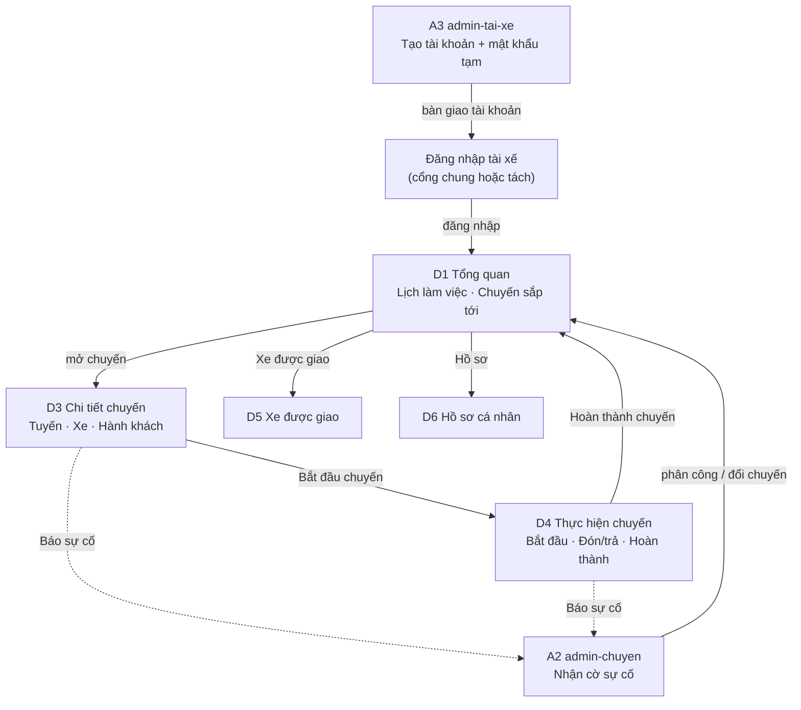

# 02 — MÀN HÌNH TÀI XẾ (5 MÀN)

> Vai trò: **Tài xế** — người **thực hiện các chuyến được admin phân công**.
> Shell: **D (Driver app)**.
>
> **Thay đổi mô hình so với bản cũ:** tài xế **không tự đăng chuyến**, **không
> tự đăng ký tài khoản**, **không có Online/Offline**, **không nhận chuyến tự
> do** (không có chợ chuyến). Admin tạo chuyến, gán xe và phân công tài xế tại
> A2; tài khoản tài xế do admin tạo tại A3.
>
> **Bổ sung (PA3.2):** tài xế có **2 thao tác xác nhận lệnh** — "Tôi đã nhận
> lệnh" (D3) và "Tôi đã có mặt tại bến" (D3) — để admin theo dõi tiến độ phối
> hợp; đây là xác nhận **lệnh đã được phân công**, không phải xin nhận chuyến.
>
> **Đã bỏ:** màn đăng chuyến, màn đánh giá, màn hỗ trợ, ticket, chat, FAQ,
> hotline, ngân hàng/ví, upload giấy tờ, duyệt KYC, màn "Chuyến được phân công"
> (D2 cũ — danh sách chuyến đã gộp vào lịch chạy ở Tổng quan D1).
>
> **Giữ:** báo sự cố chuyến dạng thao tác đơn giản trong chi tiết chuyến.

---

## 1. Nguyên tắc & mô hình

- Mỗi chuyến do **admin lập kế hoạch**: tuyến, ngày giờ, xe, tài xế, giá vé,
  tiền công tài xế.
- Tài xế chỉ thấy **các chuyến được phân công cho mình**.
- Chuyến đã công bố vẫn tồn tại khi tài xế đăng xuất; không có trạng thái
  Online/Offline.
- Khách đặt vé trên chuyến đã mở bán; đơn được hệ thống tự xác nhận.
- Tài xế cập nhật trạng thái **từng hành khách** khi chạy chuyến.
- Trạng thái chuyến/vé đồng bộ giữa khách (B7), tài xế (D3–D4) và admin (A2/A6).
- Sự cố chuyến: tài xế báo bằng modal; admin thấy cờ sự cố ở A1/A2 và xử lý.

### Luồng nghiệp vụ cốt lõi

```
Admin tạo tài khoản tài xế (A3)
  └─ Tài xế nhận thông tin đăng nhập
Đăng nhập
  └─ Vào thẳng Tổng quan (D1)
Admin tạo chuyến + gán xe + phân công tài xế (A2)
  └─ Chuyến xuất hiện ở lịch chạy trên Tổng quan (D1)
Xem chuyến ở Tổng quan (D1)
  └─ Mở chi tiết chuyến (D3): tuyến, xe, hành khách, điểm đón
Thực hiện chuyến (D4)
  └─ Bắt đầu → đón/trả từng khách → thu tiền mặt → hoàn thành
Hoàn thành chuyến
  └─ Cập nhật trạng thái vé + ghi nhận tiền công
Xem xe được giao (D5), hồ sơ (D6)
```

---

## 2. Sơ đồ luồng tài xế



**Chuỗi rút gọn:**

```
Admin tạo TK (A3) → Tài xế đăng nhập → Tổng quan (D1)
→ Chuyến ở Tổng quan (D1) → Chi tiết chuyến (D3)
→ Bắt đầu chuyến → Thực hiện chuyến (D4) → Hoàn thành
Nhánh phụ: Xe được giao (D5), Hồ sơ (D6), Báo sự cố (D3/D4 → A2)
```

---

## 3. Danh sách 5 màn

| Mã | Màn hình | Thư mục | Chức năng |
|----|----------|---------|-----------|
| D1 | Tổng quan | `tai-xe-tong-quan` | Lịch làm việc, chuyến sắp tới |
| D3 | Chi tiết chuyến | `tai-xe-chi-tiet-chuyen` | Tuyến, xe, hành khách, báo sự cố |
| D4 | Thực hiện chuyến | `tai-xe-dieu-hanh` | Bắt đầu, đón/trả khách, hoàn thành |
| D5 | Xe được giao | `tai-xe-xe` | Thông tin xe, tình trạng xe |
| D6 | Hồ sơ cá nhân | `tai-xe-ho-so` | Thông tin, giấy phép, tài khoản |

---

## 4. Chi tiết từng màn

### D1. Tổng quan — `screens/tai-xe-tong-quan/`

- **Tác dụng:** "buồng lái" hằng ngày — tài xế nắm lịch chạy và việc cần làm.
- **Nhiệm vụ chính:**
  - Lời chào + ngày hôm nay.
  - KPI: **chuyến hôm nay**, **chuyến sắp tới**, **khách hôm nay** (số đơn giản).
  - **Lịch làm việc**: danh sách chuyến sắp tới (giờ, tuyến, xe, số khách) kèm
    **chip trạng thái lệnh** (Chưa nhận / Đã nhận / Có mặt) và **cờ trễ**; nút
    **"Xác nhận nhận chuyến"** khi chưa nhận lệnh.
  - Lối tắt: Xe được giao (D5), Hồ sơ (D6).
  - Cảnh báo nhẹ nếu có chuyến bắt đầu trong 2 giờ tới.
- **Thành phần:** `.stat-card`, `.ride-card` (chuyến sắp tới), `.badge` trạng
  thái, `.empty-state`, `.btn`.
- **Trạng thái:** chưa có chuyến, có chuyến hôm nay, loading.
- **Không có:** toggle Online/Offline, chuông thông báo, nút nhận chuyến.
- **Ưu tiên:** P1.

### D3. Chi tiết chuyến — `screens/tai-xe-chi-tiet-chuyen/`

- **Tác dụng:** xem đầy đủ một chuyến trước và trong khi chạy.
- **Nhiệm vụ chính:**
  - Thông tin tuyến: điểm đi/đến, giờ khởi hành, các điểm dừng/đón.
  - Thông tin xe: biển số, loại xe, sức chứa.
  - Danh sách hành khách: tên, SĐT (che bớt), điểm đón/trả, trạng thái đón,
    trạng thái thanh toán.
  - Tổng quan: số khách, ghế trống, doanh thu tiền mặt dự kiến.
  - **Trạng thái lệnh phân công** (khối riêng, xem §5.1): chip mức hiện tại +
    chuỗi 4 bậc (Chưa nhận → Đã nhận → Đang chuẩn bị → Đã có mặt).
  - Hành động:
    - **Tôi đã nhận lệnh** (khi chưa nhận) → chuyển `Đã nhận lệnh`.
    - **Tôi đã có mặt tại bến** (khi đã nhận lệnh, trong ngày chạy) → chuyển
      `Đã có mặt`.
    - **Bắt đầu chuyến** — **chỉ bật khi đã "Đã có mặt"** và chuyến ở trạng
      thái Sắp tới trong ngày chạy; chuyển sang D4.
    - **Báo sự cố** (modal, xem §6) — báo sự cố **không** hủy chuyến.
    - **Gọi khách** (chỉ khi chuyến sắp tới/đang chạy).
  - Nếu chuyến đã hủy: banner lý do, không có thao tác.
  - Nếu chuyến đang thực hiện: tài xế tiếp tục dùng D4; mọi ngoại lệ do admin
    quyết định.
- **Thành phần:** panel chuyến, `.timeline` điểm dừng, `.data-table`/list hành
  khách, `.status-badge`, `.badge` thanh toán, `.modal`, `.btn`.
- **Trạng thái:** chưa tới giờ, đã bắt đầu, đã hủy, sự cố đã báo.
- **Ưu tiên:** P1.

### D4. Thực hiện chuyến — `screens/tai-xe-dieu-hanh/`

- **Tác dụng:** công cụ chạy chuyến — cập nhật trạng thái từng hành khách.
- **Nhiệm vụ chính:**
  - Header chuyến: tuyến, giờ, xe, tiến độ `đã trả / tổng khách`.
  - Danh sách khách theo thứ tự điểm đón:
    - Chuyển trạng thái: **Chờ đón → Đã đón → Đã trả**.
    - Đánh dấu **Không lên xe** (kèm xác nhận) — chỉ khi khách chưa `Đã đón`.
    - Đánh dấu **Đã thu tiền mặt** cho từng khách (chỉ sau khi khách `Đã đón`).
  - Nút gọi khách.
  - **Báo sự cố** (modal) — tài xế vẫn tiếp tục cập nhật chuyến; admin quyết định
    tiếp tục / thay xe / đổi tài xế / xử lý ngoại lệ.
  - **Hoàn thành chuyến** chỉ khi **mọi khách** đã ở trạng thái cuối (`Đã trả`,
    `Không lên xe`, `Đã hủy`); modal tổng kết (số khách, tiền mặt đã thu) rồi cập
    nhật trạng thái chuyến. Ngoại lệ do admin xử lý tại A2.
- **Thành phần:** checklist hành khách, nút trạng thái lớn (`.btn`), `.progress`,
  `.modal`, `.toast`, `.status-badge`, `.timeline`.
- **Trạng thái:** chưa tới điểm, khách vắng (no-show), sự cố, chưa đủ điều kiện
  hoàn thành, hoàn thành.
- **Không có:** bản đồ realtime bắt buộc, chia sẻ vị trí, chat với khách.
- **Ưu tiên:** P1.

### D5. Xe được giao — `screens/tai-xe-xe/`

- **Tác dụng:** tài xế biết xe mình sẽ chạy và tình trạng xe.
- **Nhiệm vụ chính:**
  - Danh sách xe được admin gán: biển số, loại xe, sức chứa, tình trạng
    (`Đang hoạt động / Bảo trì / Ngưng`).
  - Hạn đăng kiểm, bảo hiểm (chỉ hiển thị).
  - Ghi chú: thông tin do admin cập nhật tại A4.
- **Thành phần:** `.fleet-card`, `.badge`, `.empty-state`.
- **Trạng thái:** chưa được gán xe, xe đang bảo trì, giấy tờ sắp hết hạn.
- **Không có:** thêm/sửa xe, upload giấy tờ, yêu cầu duyệt.
- **Ưu tiên:** P2.

### D6. Hồ sơ cá nhân — `screens/tai-xe-ho-so/`

- **Tác dụng:** thông tin tài xế và tài khoản đăng nhập.
- **Nhiệm vụ chính:**
  - Ảnh, họ tên, SĐT, email, ngày tham gia.
  - Giấy phép lái xe: số, hạng, ngày hết hạn (chỉ đọc — admin cập nhật).
  - Đổi mật khẩu; đăng xuất.
- **Thành phần:** avatar, `.field` (thông tin chỉ đọc), form đổi mật khẩu,
  `.form-status`, `.btn`.
- **Trạng thái:** lưu thành công, sai mật khẩu, lỗi validate.
- **Không có:** ngân hàng, ví, upload giấy tờ, cài đặt thông báo.
- **Ưu tiên:** P1.

---

## 5. Trạng thái nghiệp vụ

**Trạng thái chuyến:**

```
Sắp tới → Đang thực hiện → Hoàn thành
   └── Đã hủy (admin hủy; chỉ khi chuyến CHƯA bắt đầu)
```

- Chuyến do admin tạo và phân công; tài xế **không** đổi trạng thái chuyến.
- Chỉ bắt đầu trong ngày chạy; trước đó chỉ xem.
- Hoàn thành khi **mọi** hành khách ở trạng thái cuối (`Đã trả` / `Không lên xe`
  / `Đã hủy`); ngoại lệ (kẹt khách, sự cố) do admin xử lý tại A2.
- Chuyến **đang thực hiện** không hủy qua luồng thường; dùng báo sự cố để admin
  xử lý (tiếp tục / thay xe / đổi tài xế / kết thúc sớm).

**Trạng thái hành khách trên chuyến (tài xế cập nhật):**

```
Chờ đón → Đã đón → Đã trả
   ├── Không lên xe (chỉ khi chưa Đã đón)
   └── Đã hủy (khách hủy trước / admin hủy vé / admin hủy chuyến)
```

Ánh xạ sang trạng thái vé (khách/admin): `Chờ đón→Đã đặt`, `Đã đón→Đã đón`,
`Đã trả→Hoàn thành`, `Không lên xe→Không lên xe`, `Đã hủy→Đã hủy`.

**Trạng thái thanh toán:** `Chưa thu → Đã thu` (tiền mặt, tài xế xác nhận ở D4;
chỉ gắn với khách đã `Đã đón`). Không có hoàn tiền.

### 5.1 Trạng thái lệnh phân công (lớp mới, tách khỏi trạng thái chuyến)

```
Chưa nhận lệnh → Đã nhận lệnh → (Đang chuẩn bị) → Đã có mặt
```

- Bốn mức này **không đổi** 4 trạng thái chuyến ở trên; chúng mô tả tài xế đã
  phản hồi lệnh của admin tới đâu.
- Tài xế bấm 2 nút: **Tôi đã nhận lệnh** (bất kỳ lúc nào sau khi được phân
  công) và **Tôi đã có mặt tại bến** (trong ngày chạy).
- **Đang chuẩn bị** là mức **suy ra**: đã nhận lệnh + trong ngày chạy + chưa có
  mặt; không có nút riêng.
- **Bắt đầu chuyến** chỉ khả dụng sau khi ở mức **Đã có mặt**.
- Cờ trễ chỉ hiển thị (không thao tác): `Trễ N'` (trễ khởi hành) hoặc
  `Quá hành trình +N'`.
- Lớp này đồng bộ sang admin tại A2 (cột Tài xế, drawer) và A1 (chip + KPI).

---

## 6. Báo sự cố chuyến (giữ lại, tối giản)

- **Vị trí:** nút "Báo sự cố" trong D3 và D4.
- **Cách hoạt động:**
  1. Mở modal: chọn loại sự cố (Kẹt xe · Hỏng xe · Tai nạn · Thời tiết ·
     Khác), nhập ghi chú ngắn.
  2. Gửi → gắn cờ **Sự cố** lên chuyến, lưu thời điểm và người báo.
  3. Cờ **Sự cố** hiển thị **cảnh báo ở A1** (mục cần xử lý) và được admin
     **xử lý tại A2** (chi tiết chuyến): đánh dấu **Đã xử lý** kèm ghi chú.
- **Tài xế vẫn tiếp tục chạy và cập nhật D4** sau khi báo sự cố; báo sự cố không
  khóa thao tác.
- **Không có:** ticket, chat, phản hồi qua lại, hotline, đính kèm ảnh.
- **Không tự động** hủy chuyến hay đổi trạng thái vé; admin quyết định tiếp tục /
  thay xe / đổi tài xế / kết thúc sớm.

---

## 7. Quy tắc nghiệp vụ

1. Tài xế chỉ thấy chuyến được phân công cho mình.
2. Không có Online/Offline; chuyến vẫn tồn tại khi tài xế đăng xuất.
3. Không nhận quá sức chứa; A2 chặn khi tạo/sửa chuyến nếu số ghế vượt sức chứa
   xe.
4. Một tài xế và một xe không bị phân công hai chuyến chồng khoảng thời gian vận
   hành (giờ khởi hành + thời lượng dự kiến); A2 chặn khi lưu.
5. Tài xế không sửa chuyến, không hủy chuyến, không đổi xe.
6. Bắt đầu chuyến chỉ trong ngày chạy **và** sau khi tài xế xác nhận **Đã có
   mặt tại bến**. Hoàn thành chỉ khi mọi khách ở trạng thái cuối (`Đã trả`/
   `Không lên xe`/`Đã hủy`); ngoại lệ do admin xử lý tại A2.
7. Trạng thái khách tài xế cập nhật đồng bộ sang vé ở khách (B7) và admin
   (A2/A6).
8. Tiền công chuyến do admin nhập ở A2; tài xế không xem màn thu nhập riêng.
9. Báo sự cố chỉ tạo cờ, không thay đổi trạng thái chuyến/vé.
10. Tài khoản tài xế do admin tạo; tài xế không tự đăng ký.
11. Tài xế xác nhận lệnh bằng 2 nút (nhận lệnh, có mặt); đây là **xác nhận lệnh
    đã được admin phân công**, không phải nhận chuyến tự do — tài xế vẫn không
    tự chọn/đổi/hủy chuyến.

---

## 8. Điều hướng

```
Tổng quan | Xe được giao | Hồ sơ
```

- Trang chủ app: D1.
- D1 → D3/D5/D6 (mở chuyến từ lịch chạy).
- D3 → D4.
- D4 hoàn thành → toast + quay lại D1.
- Header chỉ có avatar + đăng xuất; **không** có chuông, không có "Hỗ trợ".

---

## 9. Luồng chính rút gọn

```
Admin tạo TK tài xế (A3) → bàn giao
→ Tài xế đăng nhập → Tổng quan (D1)
→ Admin tạo chuyến + phân công (A2) → hiện ở D1
→ Khách đặt vé (B5) → danh sách khách đầy lên ở D3
→ Đến ngày chạy: D3 → Bắt đầu → D4
→ Đón/trả từng khách + thu tiền mặt → Hoàn thành
```

> Khu tài xế tái dùng tối đa `.driver-panel` đã có ở trang chủ để giữ nhận diện,
> nhưng **không** tái dùng khối đăng ký/CTA tài xế.