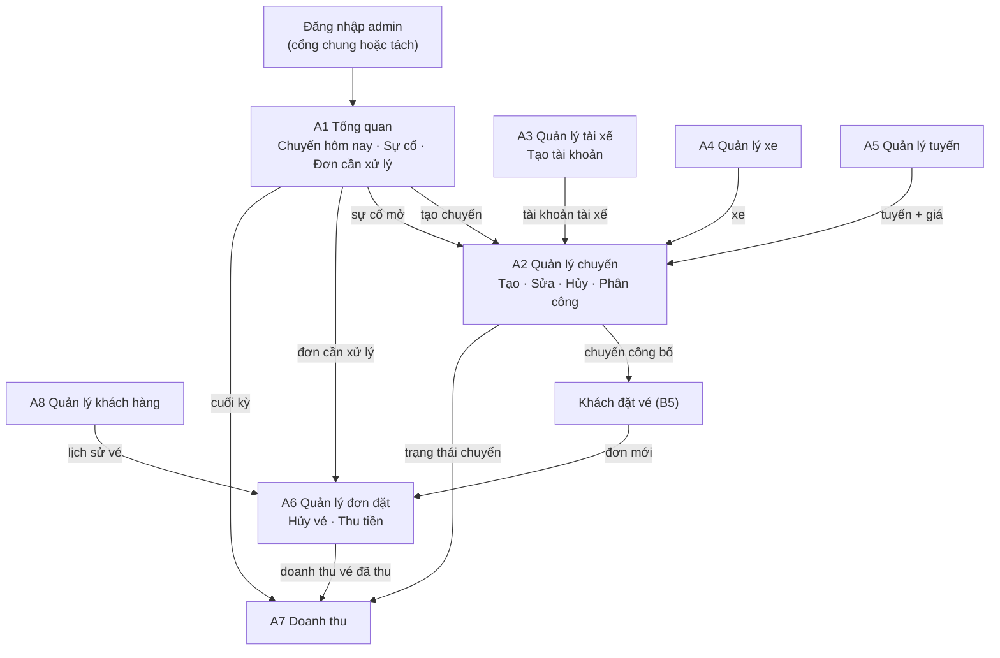

# 03 — MÀN HÌNH QUẢN TRỊ VIÊN (8 MÀN + CỔNG ĐĂNG NHẬP)

> Vai trò: **Quản trị viên / điều hành**. Shell: **A (Admin)** — sidebar trái
> cố định + topbar + breadcrumb.
>
> **Trạng thái 2026-11-02:** đã build đủ 8 màn nghiệp vụ + cổng đăng nhập
> (`admin/screens/dang-nhap` → `admin/index.html`), tổng 9 `screen.json`.
>
> Đây là khu **dày dữ liệu**; dùng `.data-table`, `.stat-card`, `.filter-bar`,
> `.modal`, `.tabs`, `.pagination`, `.empty-state` (xem `00-tong-quan.md` §5).
>
> **Admin là người lập kế hoạch vận hành:** tạo chuyến, xem lịch điều phối tài
> nguyên, gán xe, phân công tài xế. Khách đặt vé trên chuyến đã công bố; tài xế
> thực hiện chuyến; admin theo dõi trạng thái, xử lý sự cố, hủy vé, theo dõi thu
> tiền và xem doanh thu.
>
> **Đã bỏ:** cấu hình hệ thống, audit log, thông báo broadcast, khuyến mãi, CMS,
> ticket hỗ trợ, quản lý khiếu nại, ví đối tác/payout, duyệt KYC nhiều bước,
> màn điều phối A9, trang sự cố riêng.

---

## 1. Danh sách 8 màn nghiệp vụ

| Mã | Màn hình | Thư mục | Output | Chức năng | Trạng thái |
|----|----------|---------|--------|-----------|------------|
| A1 | Tổng quan | `tong-quan` | `admin/tong-quan.html` | Thống kê nhanh, chuyến hôm nay, sự cố | ✅ |
| A2 | Quản lý chuyến | `admin-chuyen` | `admin/admin-chuyen.html` | Tạo/sửa/hủy, phân công, lịch điều phối, sự cố | ✅ |
| A3 | Quản lý tài xế | `admin-tai-xe` | `admin/tai-xe.html` | Tạo tài khoản, quản lý thông tin/trạng thái | ✅ |
| A4 | Quản lý xe | `admin-xe` | `admin/xe.html` | Danh sách xe, sức chứa, tình trạng | ✅ |
| A5 | Quản lý tuyến | `admin-tuyen-duong` | `admin/tuyen-duong.html` | Tuyến, điểm dừng và giá vé | ✅ |
| A6 | Quản lý đơn đặt | `admin-don-dat` | `admin/don-dat.html` | Xem vé, hủy vé, theo dõi thu tiền | ✅ |
| A7 | Doanh thu | `admin-doanh-thu` | `admin/admin-doanh-thu.html` | Doanh thu thực thu và đối soát | ✅ |
| A8 | Quản lý khách hàng | `admin-khach-hang` | `admin/khach-hang.html` | Danh sách và thông tin tài khoản | ✅ |

**Cổng đăng nhập riêng:** `admin/screens/dang-nhap` → `admin/index.html`
(không tính vào 8 màn nghiệp vụ).

**Sidebar:**

```
Tổng quan
Quản lý chuyến
Quản lý tài xế
Quản lý xe
Quản lý tuyến
Quản lý đơn đặt
Doanh thu
Quản lý khách hàng
```

---

## 2. Chi tiết từng màn

### A1. Tổng quan — `screens/tong-quan/`

- **Tác dụng:** nắm nhanh tình hình vận hành trong ngày.
- **Nhiệm vụ chính:**
  - KPI: **chuyến hôm nay**, **vé đã bán**, **doanh thu hôm nay**, **khách
    mới trong tháng**, **chuyến chưa xác nhận lệnh** (cảnh báo nếu > 0).
  - Danh sách **chuyến hôm nay**: giờ, tuyến, tài xế, xe, `đã đặt / sức chứa`,
    trạng thái, kèm **chip trạng thái lệnh** và **cờ trễ** (xem A2 §4).
  - **Sự cố đang mở** — bảng nhỏ có **thời gian trôi** (tuổi đời), trạng thái
    sự cố (`Mở` / `Đang xử lý`), cảnh báo đỏ khi `Mở` quá 15 phút, lối **Xử lý
    tại A2**.
  - **Đơn cần xử lý**: yêu cầu hủy vé (quá hạn khách tự hủy), vé chưa ghi nhận
    thanh toán → mở A6.
  - Lối tắt: Tạo chuyến (A2), thêm tài xế (A3), thêm xe (A4).
- **Thành phần:** `.stat-card`, `.data-table`/`.ride-card`, `.status-badge`,
  `.badge` sự cố, `.empty-state`.
- **Trạng thái:** chưa có dữ liệu hôm nay, loading, lỗi.
- **Không có:** hàng chờ KYC, hàng chờ khiếu nại, biểu đồ phức tạp.
- **Ưu tiên:** P1.

### A2. Quản lý chuyến — `screens/admin-chuyen/`

- **Tác dụng:** màn trung tâm — lập lịch và điều hành toàn bộ chuyến.
- **Nhiệm vụ chính:**
  - Danh sách chuyến, lọc theo ngày, tuyến, tài xế, trạng thái.
  - Cột: mã chuyến, tuyến, giờ, tài xế, xe, `đã đặt / sức chứa`, giá vé,
    trạng thái, cờ sự cố.
  - **Tạo chuyến** (modal/panel cùng màn):
    - Tuyến (A5), ngày giờ khởi hành, xe (A4), tài xế (A3), giá vé/ghế,
      tiền công tài xế, ghi chú.
    - **Kiểm tra khi lưu:** xe và tài xế không trùng khoảng thời gian vận hành
      với chuyến khác (giờ khởi hành + thời lượng dự kiến); số ghế không vượt
      sức chứa xe; tuyến/xe/tài xế đang hoạt động; đủ dữ liệu bắt buộc.
  - **Sửa chuyến**: cho phép khi chưa có vé hoặc chỉ sửa thông tin không ảnh
    hưởng vé; nếu đã có khách, cảnh báo rõ các trường bị khóa.
  - **Phân công / đổi tài xế, đổi xe** khi chưa khởi hành (vẫn kiểm tra trùng
    lịch).
  - **Hủy chuyến**: chỉ khi chuyến **chưa bắt đầu** (Sắp tới); modal xác nhận +
    lý do; vé liên quan chuyển `Đã hủy` (không hoàn tiền) và vào danh sách xử lý
    ở A6. Chuyến đang thực hiện → xử lý qua báo sự cố, **không hủy trực tiếp**.
  - Xem chi tiết chuyến: danh sách vé/hành khách, trạng thái đón/trả, thanh
    toán; **trạng thái phân công** (xem §4) và **xử lý sự cố** theo quy trình
    (xem §4.2).
  - **Lịch điều phối (PA2.1)** — chế độ xem cạnh bảng: lưới **tài nguyên ×
    khung giờ** của 1 ngày, chuyển nhóm **Theo tài xế / Theo xe**; chuyến hiển
    thị thành khối theo giờ; bấm khối mở chi tiết; bấm **dấu +** ở một tài
    nguyên để mở form tạo chuyến đã điền sẵn tài nguyên + ngày.
  - **Dải tình trạng tài nguyên (PA2.2)** trong modal tạo/sửa chuyến: khi đã
    chọn ngày/giờ, hiển thị lịch bận 24h của **xe** và **tài xế** đang chọn,
    **khoá lựa chọn trùng lịch** (ghi rõ "trùng lịch") và cảnh báo.
  - **Trạng thái lệnh phân công**: cột Tài xế có chip `Chưa nhận / Đã nhận /
    Đang chuẩn bị / Đã có mặt`; drawer có khối 4 bậc + **cờ trễ** tự tính.
- **Thành phần:** `.filter-bar`, `.data-table`, `.tabs`, `.badge`, `.modal`
  (tạo/sửa/hủy/xử lý sự cố), `.timeline` (lịch sử trạng thái), `.pagination`,
  `.empty-state`; mở rộng: chế độ xem lịch (`.lich-*`), dải tài nguyên
  (`.avail-*`), chip lệnh + cờ trễ (`.sb--red`), vòng đời sự cố
  (`.suco-*`, bước xử lý).
- **Trạng thái:** chưa có chuyến, trùng lịch tài xế/xe, chuyến đã có khách
  (khóa sửa quan trọng), chuyến đã hủy, sự cố mở.
- **Ưu tiên:** P0.

### A3. Quản lý tài xế — `screens/admin-tai-xe/`

- **Tác dụng:** nơi duy nhất tạo và quản lý tài khoản tài xế.
- **Nhiệm vụ chính:**
  - Danh sách tài xế: họ tên, SĐT, giấy phép, trạng thái, số chuyến.
  - **Tạo tài khoản**: họ tên, SĐT/email, số GPLX + hạng + hạn, mật khẩu tạm;
    hiển thị thông tin đăng nhập một lần để bàn giao.
  - Sửa thông tin cá nhân/giấy phép.
  - Khóa / mở khóa tài khoản; đặt lại mật khẩu.
  - Xem các chuyến được phân công gần đây.
- **Thành phần:** `.filter-bar`, `.data-table`, form trong `.modal`, `.badge`
  trạng thái, `.empty-state`, `.pagination`.
- **Trạng thái:** chưa có tài xế, trùng SĐT/email, tài khoản bị khóa.
- **Không có:** duyệt KYC, upload giấy tờ, hồ sơ chờ duyệt.
- **Ưu tiên:** P1.

### A4. Quản lý xe — `screens/admin-xe/`

- **Tác dụng:** quản lý danh mục phương tiện dùng để phân công chuyến.
- **Nhiệm vụ chính:**
  - Danh sách xe: biển số, loại, sức chứa, tài xế phụ trách, tình trạng.
  - Thêm/sửa xe; gán tài xế mặc định (tuỳ chọn).
  - Đổi trạng thái: `Đang hoạt động / Bảo trì / Ngưng sử dụng`.
  - Nhập hạn đăng kiểm/bảo hiểm (chỉ để hiển thị cảnh báo).
  - Xóa xe chưa từng gắn chuyến; xe đã có chuyến chỉ được ngưng.
- **Thành phần:** `.filter-bar`, `.data-table`, `.modal` form, `.badge`,
  `.empty-state`.
- **Trạng thái:** chưa có xe, trùng biển số, xe đang bảo trì, giấy tờ sắp hết
  hạn.
- **Ưu tiên:** P1.

### A5. Quản lý tuyến — `screens/admin-tuyen-duong/`

- **Tác dụng:** quản lý "sản phẩm" cốt lõi: tuyến, điểm dừng và giá.
- **Nhiệm vụ chính:**
  - CRUD tuyến: điểm đi, điểm đến, khoảng cách/thời lượng dự kiến.
  - Quản lý điểm dừng/điểm đón theo thứ tự.
  - Giá vé cơ bản theo tuyến (giá/ghế).
  - Bật/tắt tuyến (ngừng sử dụng không xóa lịch sử).
- **Thành phần:** `.data-table`, `.modal`/panel form, `.badge` (đang chạy/tạm
  dừng), `.empty-state`, `.pagination`.
- **Trạng thái:** trùng tuyến, giá không hợp lệ, xác nhận ngừng tuyến.
- **Ưu tiên:** P1.

### A6. Quản lý đơn đặt — `screens/admin-don-dat/`

- **Tác dụng:** tra soát vé và xử lý ngoại lệ đơn đặt.
- **Nhiệm vụ chính:**
  - Danh sách đơn: mã vé, khách, chuyến/tuyến, ghế, trạng thái vé, trạng thái
    thanh toán.
  - Lọc theo ngày, tuyến, chuyến, trạng thái, tài xế.
  - Chi tiết đơn (drawer/panel): khách, ghế, điểm đón/trả, lịch sử trạng thái,
    tiền mặt đã thu.
  - **Hủy vé thay khách** (modal + lý do) — dùng khi khách quá hạn tự hủy.
  - **Theo dõi thanh toán**: xem `Chưa thu / Đã thu` theo vé và chỉnh khi cần,
    đối chiếu tiền mặt tài xế ghi ở D4.
  - **Không có hoàn tiền**; vé hủy trước khi thu tiền không phát sinh khoản hoàn.
  - Không có ghép tài xế vào đơn; đơn thuộc chuyến đã phân công.
- **Thành phần:** `.filter-bar`, `.data-table`, `.tabs`, drawer chi tiết,
  `.timeline`, `.status-badge`, `.modal`, `.empty-state`, `.pagination`.
- **Trạng thái:** không có đơn, đơn đã hủy, đơn chưa ghi nhận thanh toán, lỗi.
- **Ưu tiên:** P1.

### A7. Doanh thu — `screens/admin-doanh-thu/`

- **Tác dụng:** thống kê **doanh thu thực thu** và đối soát đơn giản.
- **Nhiệm vụ chính:**
  - Chọn khoảng thời gian (ngày/tuần/tháng).
  - **Doanh thu = tổng tiền mặt thực thu** (chỉ vé `Đã thu`), **không** tính vé
    đã đặt nhưng chưa thu hay khách `Không lên xe`.
  - Số vé đã thu, số chuyến hoàn thành, số vé hủy, số vé `Không lên xe`.
  - Doanh thu theo ngày, theo tuyến, theo chuyến.
  - Tiền công tài xế và **lãi gộp tạm tính** = doanh thu thực thu − tiền công.
  - Bảng đối soát theo chuyến: số vé đặt, số vé đã thu, tiền mặt đã thu, tiền
    công, chênh lệch (nếu có).
  - Xuất CSV (tuỳ chọn).
- **Thành phần:** `.filter-bar`, `.stat-card`, `.data-table`, biểu đồ đơn giản
  (`.chart`), `.badge` chênh lệch, `.empty-state`.
- **Trạng thái:** không có dữ liệu kỳ, loading, lỗi xuất.
- **Không có:** ví đối tác, lệnh rút, payout, hoàn tiền, hoa hồng nhiều tầng.
- **Ưu tiên:** P2.

### A8. Quản lý khách hàng — `screens/admin-khach-hang/`

- **Tác dụng:** tra cứu và quản lý tài khoản khách.
- **Nhiệm vụ chính:**
  - Danh sách khách: họ tên, SĐT, email, ngày tạo, trạng thái, số vé đã đặt.
  - Tìm/lọc theo tên, SĐT, trạng thái.
  - Xem chi tiết: thông tin tài khoản + lịch sử vé (liên kết A6).
  - Khóa/mở khóa tài khoản; đặt lại mật khẩu.
- **Thành phần:** `.filter-bar`, `.data-table`, drawer chi tiết, `.badge`,
  `.modal`, `.empty-state`, `.pagination`.
- **Trạng thái:** empty theo lọc, tài khoản bị khóa, loading.
- **Ưu tiên:** P2.

---

## 3. Luồng vận hành điển hình



**Chuỗi rút gọn:**

```
Đăng nhập → A1 (nắm chuyến hôm nay, sự cố, đơn cần xử lý)
→ A3 tạo tài khoản tài xế (nếu chưa có)
→ A4 thêm xe, A5 thêm tuyến/giá
→ A2 tạo chuyến + gán xe + phân công tài xế → công bố
→ Khách đặt vé → A6 theo dõi, hủy vé khi cần
→ Tài xế chạy chuyến (D4), thu tiền mặt → trạng thái + thanh toán cập nhật về A2/A6
→ A7 xem doanh thu thực thu, đối soát đơn giản
```

---

## 4. Trạng thái & quy tắc

**Trạng thái chuyến:** `Sắp tới → Đang thực hiện → Hoàn thành`; nhánh `Đã hủy`
(chỉ khi chuyến **chưa bắt đầu**).

**Trạng thái lệnh phân công (lớp mới, tách khỏi trạng thái chuyến):**
`Chưa nhận lệnh → Đã nhận lệnh → (Đang chuẩn bị) → Đã có mặt`. Tài xế bấm 2 nút
(nhận lệnh, có mặt); `Đang chuẩn bị` là mức suy ra. Admin thấy lớp này ở A2 (cột
Tài xế + drawer) và A1 (chip + KPI "chuyến chưa xác nhận"). **Cờ trễ** chỉ hiển
thị: `Trễ N'` (trễ khởi hành) / `Quá hành trình +N'`, suy từ thời gian — không
thao tác, quyết định vẫn thuộc admin.

**Vòng đời sự cố (§4.2):** `Mở → Đang xử lý → Đã xử lý`; mỗi bước ghi nhận
người xử lý, biện pháp, ghi chú và thời điểm; A1 hiển thị tuổi đời để chống bỏ
quên.

**Trạng thái vé:** `Đã đặt → Đã đón → Hoàn thành`; nhánh `Không lên xe`, `Đã hủy`.

**Thanh toán:** `Chưa thu → Đã thu` (tiền mặt, tài xế ghi ở D4; chỉ gắn với vé đã
`Đã đón`). **Không có hoàn tiền.**

**Quy tắc bắt buộc:**

1. Không tạo chuyến khi tuyến bị tắt hoặc xe/tài xế không hoạt động.
2. Không phân công trùng khoảng thời gian vận hành cho cùng tài xế hoặc cùng xe.
3. Số ghế bán không vượt sức chứa xe; hệ thống **chặn đặt trùng ghế** đã có vé.
4. Hủy chuyến chỉ khi chuyến chưa bắt đầu, phải có lý do; vé liên quan chuyển
   `Đã hủy`.
5. Chuyến đang thực hiện **không hủy trực tiếp**; dùng báo sự cố để admin xử lý.
6. Chuyến chỉ `Hoàn thành` khi mọi vé ở trạng thái cuối (`Hoàn thành` / `Không
   lên xe` / `Đã hủy`); ngoại lệ do admin xử lý kèm ghi chú.
7. Không xóa cứng chuyến/tài xế/xe đã phát sinh dữ liệu; dùng trạng thái.
8. Tiền công tài xế nhập khi tạo/sửa chuyến; A7 dùng để tính lãi gộp.
9. Mọi thay đổi trạng thái chuyến/vé đồng bộ tới khách (B7) và tài xế (D3–D4).
10. Không có hoàn tiền; khách chỉ tự hủy trước 12 giờ, sau đó admin xử lý.
11. Không có cấu hình hệ thống: các ngưỡng (hủy trước 12 giờ, giữ ghế, hạn chót
    đặt) là hằng số trong code.
12. Xếp chuyến phải kiểm tra tài nguyên rảnh: modal tạo/sửa chuyến khoá lựa chọn
    xe/tài xế **trùng khung giờ vận hành** với chuyến khác trong cùng ngày.
13. **Bắt đầu chuyến** ở phía tài xế chỉ khả dụng sau khi tài xế xác nhận **Đã
    có mặt tại bến** (đồng bộ với trạng thái lệnh ở A2).
14. Sự cố phải đi đúng vòng đời và có bằng chứng: `Mở → Đang xử lý → Đã xử lý`,
    kèm người xử lý, biện pháp và **kết quả bắt buộc** khi đóng (xem §4.2).

### 4.2 Quy trình xử lý sự cố (A2)

1. Tài xế báo sự cố (loại + ghi chú) → chuyến mang cờ **Sự cố** (`Mở`); xuất
   hiện ở drawer A2 và hàng đợi A1 (kèm tuổi đời).
2. Admin **"Bắt đầu xử lý"**: chọn người xử lý + biện pháp dự kiến + ghi chú →
   `Đang xử lý`; nhật ký ghi thêm một mốc.
3. Biện pháp `Thay xe` / `Đổi tài xế` dùng luồng đổi tài nguyên của A2.
4. Admin **"Ghi nhận kết quả"**: biện pháp thực tế + **ghi chú kết quả (bắt
   buộc)** → `Đã xử lý`; cờ sự cố trên bảng được gỡ, nhật ký lưu đủ 3 mốc.
5. `Kết thúc sớm` là một kết quả của bước 4 (kèm nhắc đối soát vé ở A6).

---

## 5. Điều hướng & phân quyền

- Admin đăng nhập vào A1; sidebar 8 mục khớp 8 màn.
- Breadcrumb: `Tổng quan / Quản lý chuyến / Tạo chuyến`.
- Hành động phá hủy (hủy chuyến, hủy vé, khóa tài khoản) đều qua `.modal`
  xác nhận + toast kết quả.
- Không có màn/phân hệ nào khác ngoài 8 màn trong tài liệu này.

---

## 6. Hiện trạng triển khai (2026-11-02)

- Đã build `admin/index.html` + A1–A8; `node build.js` pass.
- A2 đã có **chế độ Lịch điều phối** (Bảng | Lịch, Theo tài xế / Theo xe), dải
  tình trạng rảnh trong modal tạo/sửa, chip trạng thái lệnh + cờ trễ, vòng đời
  sự cố trong drawer (`chuyen-incident.js`).
- A1 có hàng đợi sự cố kèm tuổi đời, chip lệnh và cờ trễ.
- A3–A8 đã có danh sách, bộ lọc, modal tạo/sửa, drawer chi tiết.
- **Còn lệch đặc tả:** A1 còn KPI "Tài xế đang online"; `monitor.html` còn câu
  "tự động tạm khoá nhận chuyến"; shell còn chuông `i-bell`; A1 dùng shell
  partial riêng thay vì `admin/components/admin-shell.html`.
- **Output không đồng nhất:** A2 và A7 có tiền tố `admin-`, A3–A6/A8 không;
  thư mục A1 là `tong-quan` (không phải `admin-tong-quan`).
