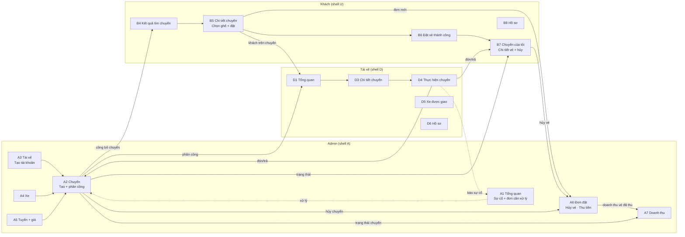
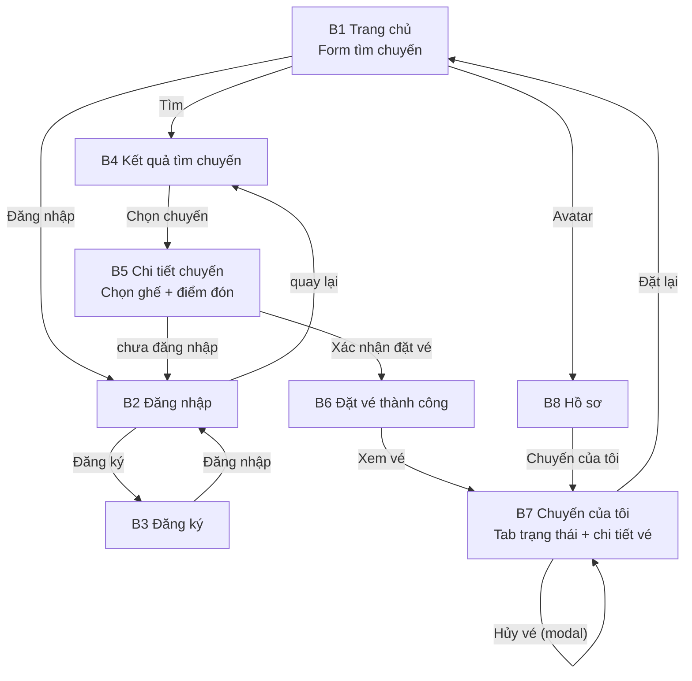
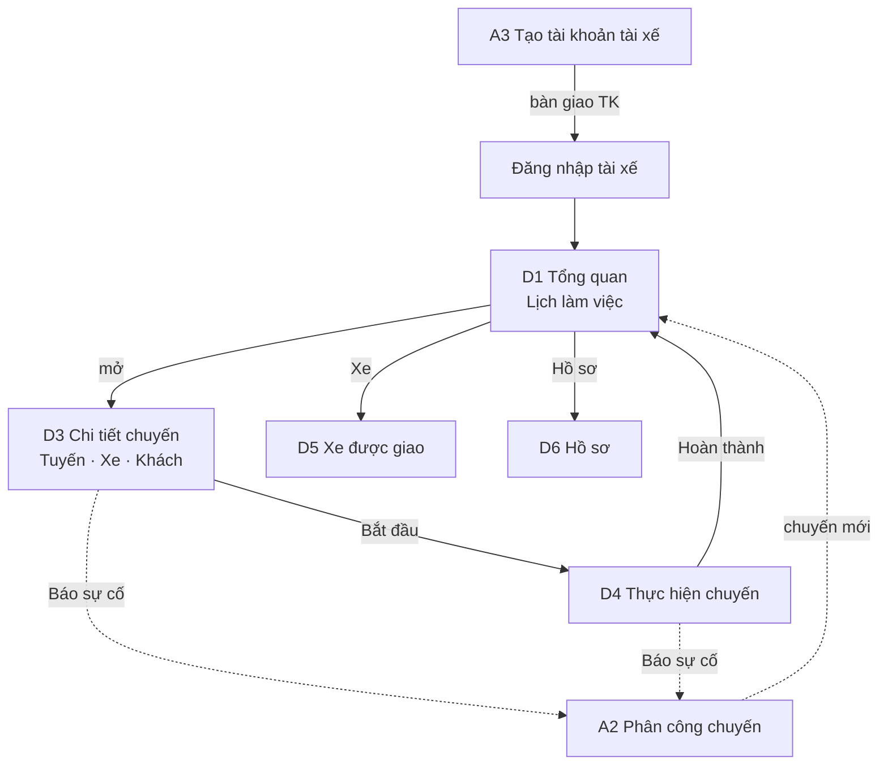
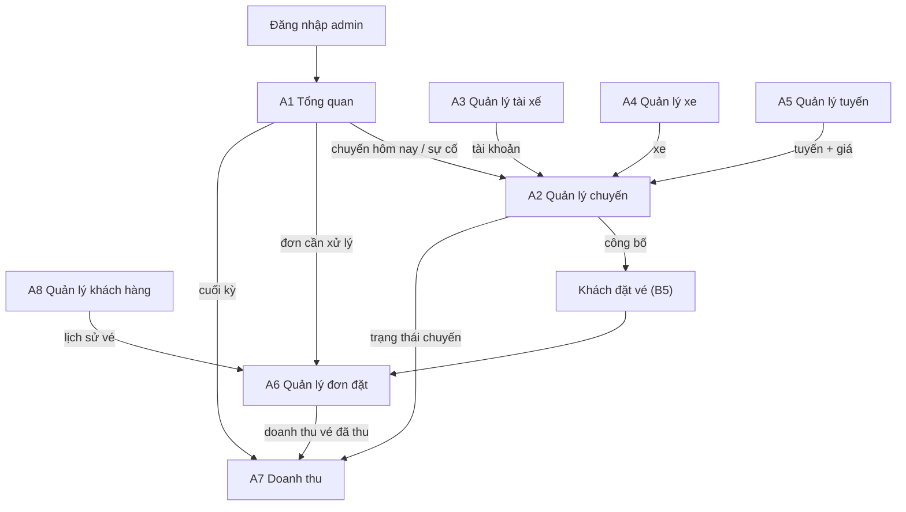

# FLOW APP — Vi Vu Việt (phạm vi tinh gọn)

> Luồng hoạt động của app sau khi tinh gọn cho project cá nhân. Cập nhật ngày
> **2026-11-02**, dựa trên source hiện có: **21 màn nghiệp vụ** (8 khách ·
> 5 tài xế · 8 admin) + **2 cổng đăng nhập riêng** + **1 trang lỗi** = 24
> `screen.json`.
>
> Nguyên tắc: chỉ giữ nghiệp vụ cốt lõi. Không có trợ giúp/hỗ trợ, ticket,
> chat, FAQ, tổng đài, thông báo, đánh giá, khuyến mãi, CMS, cấu hình, audit
> log, ví/payout, online/offline, "nhận chuyến".

---

## 1. Bức tranh tổng thể

App gồm **3 web theo vai trò** + tài nguyên chung, cùng một design system:

| Nhóm | Trạng thái | Màn |
|------|------------|-----|
| `khach-hang/` | ✅ Đã build 8 màn | `index`, `dang-nhap`, `dang-ky`, `ket-qua-tim-chuyen`, `chi-tiet-chuyen`, `dat-cho-thanh-cong`, `chuyen-cua-toi`, `ho-so` |
| `tai-xe/` | ✅ Đã build 6 màn | Cổng `index` + D1, D3–D6 |
| `admin/` | ✅ Đã build 9 màn | Cổng `index` + A1–A8 |
| `shared/` | ✅ Dùng chung | 404, header/footer, tokens, CSS/JS nền |

- Prototype tĩnh: HTML/CSS/JS thuần, build bằng `node build.js` từ
  `screens/<ten>/screen.json`.
- Không backend; phiên đăng nhập mô phỏng bằng `localStorage`
  (`vvv.auth.user`, `vvv.auth.driver`, `vvv.auth.admin`).
- **Thanh toán MVP:** tiền mặt cho tài xế khi lên xe.
- **Đã hoàn tất chuyển đổi:** `chuyen-da-dat` và `huy-doi-chuyen` không còn
  trong source; chi tiết vé + hủy nằm trong B7.

---

## 2. Mô hình hoạt động

```
Admin tạo chuyến + gán xe + phân công tài xế        (A2)
        │ công bố chuyến
        ▼
Khách tìm chuyến → chi tiết → chọn ghế → đặt vé      (B4 → B5)
        │ hệ thống tự xác nhận
        ▼
Admin thấy đơn (A6) · Tài xế thấy chuyến (D1)
        │ đến ngày chạy
        ▼
Tài xế bắt đầu, đón/trả khách, thu tiền mặt, hoàn thành (D4)
        │ cập nhật trạng thái vé + chuyến + thanh toán
        ▼
Admin xem doanh thu thực thu (vé đã thu)               (A7, A6)
```

Khác biệt cốt lõi so với bản cũ:

- Tài xế **không tự đăng chuyến**; admin lập lịch và phân công.
- Tài xế **không tự đăng ký**; admin tạo tài khoản ở A3.
- **Không** Online/Offline, không "Nhận chuyến".
- **Không** đổi vé, không đánh giá, không hỗ trợ.

---

## 3. Sơ đồ xuyên vai trò



**Chuỗi rút gọn:**

```
Admin tạo TK tài xế (A3) + xe (A4) + tuyến (A5)
→ Tạo chuyến, gán xe, phân công tài xế (A2)
→ Khách tìm (B4) → đặt vé (B5) → nhận vé (B6)
→ Tài xế thấy chuyến (D1) → xem chi tiết (D3)
→ Chạy chuyến (D4) → cập nhật trạng thái + thu tiền → hoàn thành
→ Admin xem doanh thu thực thu (A7)
```

---

## 4. Luồng khách hàng



**Happy path:**

```
Trang chủ → Kết quả tìm chuyến → Chi tiết chuyến (chọn ghế, điểm đón)
→ Đặt vé thành công → Chuyến của tôi
→ Tài xế đón/trả → vé Hoàn thành
```

**Luồng phụ:**

- Chưa đăng nhập khi đặt → Đăng nhập/Đăng ký → quay lại chi tiết.
- Hủy vé → modal trong chi tiết vé → tab Đã hủy (chỉ khi trước giờ chạy ≥ 12 giờ).
- Admin hủy chuyến → vé Đã hủy, khách thấy lý do.

**Trạng thái vé:** `Đã đặt → Đã đón → Hoàn thành`; nhánh `Không lên xe`, `Đã hủy`.
**Thanh toán:** `Chưa thu → Đã thu` (tiền mặt, tài xế ghi ở D4). Không hoàn tiền.

---

## 5. Luồng tài xế



**Chuỗi rút gọn:**

```
Admin tạo TK (A3) → Tài xế đăng nhập → Tổng quan (D1)
→ Chuyến ở Tổng quan (D1) → Chi tiết chuyến (D3)
→ Bắt đầu → Thực hiện chuyến (D4): đón/trả + thu tiền mặt
→ Hoàn thành
Nhánh: Xe được giao (D5), Hồ sơ (D6), Báo sự cố (D3/D4 → A2)
```

**Trạng thái chuyến:** `Sắp tới → Đang thực hiện → Hoàn thành`; nhánh `Đã hủy`
(chỉ khi chuyến chưa bắt đầu).
**Trạng thái khách trên chuyến:** `Chờ đón → Đã đón → Đã trả`; nhánh `Không lên
xe`, `Đã hủy`. Hoàn thành chuyến chỉ khi mọi khách ở trạng thái cuối.
**Thanh toán:** tài xế ghi `Đã thu` cho từng khách đã `Đã đón`; không hoàn tiền.

---

## 6. Luồng admin



**Chuỗi rút gọn:**

```
Đăng nhập → A1
→ A3 tạo TK tài xế · A4 xe · A5 tuyến/giá
→ A2 tạo chuyến + gán xe + phân công → công bố
→ A6 theo dõi đơn, hủy vé
→ A7 doanh thu thực thu, đối soát đơn giản
```

**Thanh toán:** `Chưa thu → Đã thu` (tiền mặt, tài xế ghi ở D4); không có hoàn
tiền.

---

## 7. Điểm nối bắt buộc (chống lệch trạng thái)

1. **Chuyến** do A2 tạo; D1 chỉ đọc chuyến được phân công; B4 chỉ thấy chuyến
   đã công bố.
2. **Vé** do B5 tạo; A6 và B7 đọc cùng trạng thái; D3/D4 cập nhật trạng thái
   khách.
3. **Trạng thái khách** ở D4 (`Chờ đón → Đã đón → Đã trả / Không lên xe`) đồng
   bộ sang trạng thái vé ở B7 và A2/A6.
4. **Trùng lịch**: A2 chặn khi xe/tài xế trùng khoảng thời gian vận hành, hoặc
   số ghế vượt sức chứa, hoặc khách đặt trùng ghế đã có vé.
5. **Hủy chuyến** ở A2 (chỉ khi chưa bắt đầu) → vé liên quan `Đã hủy` → B7 hiển
   thị lý do → A6 ghi nhận; không phát sinh hoàn tiền.
6. **Hủy vé** ở B7 (trong hạn 12 giờ) → A6 thấy đơn đã hủy; vé chưa thu giữ
   `Chưa thu`, không hoàn tiền.
7. **Thu tiền**: tài xế ghi `Đã thu` cho từng khách đã `Đã đón` ở D4; A6/A7 đọc
   cùng trạng thái thanh toán.
8. **Doanh thu**: A7 = tổng tiền thực thu (vé `Đã thu`), không tính vé đặt chưa
   thu hay khách `Không lên xe`.
9. **Tiền công** do A2 nhập; A7 dùng để tính lãi gộp.
10. **Sự cố** do D3/D4 báo → cảnh báo ở A1, xử lý ở A2; tài xế vẫn tiếp tục cập
    nhật; không tự đổi trạng thái chuyến.
11. **Hoàn thành chuyến** chỉ khi mọi vé ở trạng thái cuối, trừ ngoại lệ do admin
    xử lý.
12. **Phiên đăng nhập** tách khóa theo vai trò; mỗi vai trò có cổng riêng
    (`khach-hang/dang-nhap.html`, `tai-xe/index.html`, `admin/index.html`).

---

## 8. Hiện trạng & lỗ hổng còn lại

### Đã nối xong

1. Form tìm chuyến ở trang chủ chuyển sang `ket-qua-tim-chuyen.html`.
2. Xác nhận đặt vé chuyển sang `dat-cho-thanh-cong.html`; chưa đăng nhập thì
   sang `dang-nhap.html?next=...` rồi quay lại.
3. B7 có tab trạng thái, hủy vé bằng modal, nút "Xem vé".
4. Auth khách/tài xế/admin tôn trọng `?next=` và ghi đúng khóa phiên.
5. `chuyen-da-dat` và `huy-doi-chuyen` đã bị loại bỏ khỏi source.
6. `tai-xe/` đã có cổng + D1, D3–D6; `admin/` đã có cổng + A1–A8.
7. A2 đã có lịch điều phối, dải tài nguyên rảnh, chip lệnh + cờ trễ, vòng đời
   sự cố; A1 có hàng đợi sự cố kèm tuổi đời.

### Còn lệch đặc tả (xem chi tiết `00-tong-quan.md` §8)

8. Trang chủ + header còn FAQ/đánh giá/hỗ trợ 24/7 và link `#danh-gia`/`#faq`.
9. A1 còn KPI "Tài xế đang online"; `monitor.html` còn "tự động tạm khoá nhận
   chuyến"; admin shell còn chuông.
10. B7 chưa có tab `Không lên xe`, chưa có drawer chi tiết vé/`?ve=`, chưa có
    nút gọi tài xế.
11. B5 chưa nhắc thanh toán tiền mặt; B8/D6 chưa có đổi mật khẩu.
12. Output admin không đồng nhất; A1 dùng shell riêng; chỉ có 404, chưa có 500.
13. Dữ liệu vẫn là mock theo màn, chưa có nguồn dữ liệu chung giữa
    admin/tài xế/khách (đúng bản chất UI tĩnh).

### Tài liệu

14. `NAVIGATION.MD` đã bị xóa; điều hướng nằm trong partial header,
    `admin-shell.html`, `driver-header.html`.
15. `AGENTS.MD` snapshot 2026-10-31 còn stale (số màn, trạng thái worktree).

---

## 9. Kế hoạch dọn tiếp

| # | Việc | Vai trò | Ưu tiên | Trạng thái |
|---|------|---------|---------|------------|
| 1 | Nối form trang chủ → `ket-qua-tim-chuyen` | Khách | P0 | ✅ |
| 2 | Tự chuyển sang `dat-cho-thanh-cong` sau đặt | Khách | P0 | ✅ |
| 3 | Nối card B7 + hủy vé bằng modal | Khách | P0 | ✅ |
| 4 | Auth quay về trang trước | Khách | P1 | ✅ |
| 5 | Gộp `chuyen-da-dat` vào B7, bỏ `huy-doi-chuyen` | Khách | P0 | ✅ |
| 6 | Dựng shell D + D1–D4, D6 | Tài xế | P1 | ✅ |
| 7 | Dựng shell A + A3, A4, A5 → A2 → A1, A6 | Admin | P1 | ✅ |
| 8 | Dựng D5 và A7, A8 | TX + Admin | P2 | ✅ |
| 9 | Rà bỏ khối hỗ trợ/FAQ/hotline/chuông/online | Cả 3 | P0 | ⏳ |
| 10 | Bổ sung 500/bảo trì | Chung | P2 | ⏳ |
| 11 | Chặn trùng lịch xe/tài xế, vượt sức chứa, trùng ghế | Admin + Khách | P0 | ✅ (A2) |
| 12 | Ánh xạ trạng thái khách→vé, thêm `Không lên xe` | Cả 3 | P0 | ✅ (D4); B7 còn thiếu tab |
| 13 | Tài xế ghi `Đã thu` từng vé ở D4; A7 tính doanh thu thực thu | TX + Admin | P0 | ✅ |
| 14 | Chốt quy tắc hủy (12 giờ, chưa bắt đầu); bỏ hoàn tiền | Cả 3 | P0 | ✅ |
| 15 | Thống nhất output admin + gom component/shell | Admin | P2 | ⏳ |
| 16 | Cập nhật `AGENTS.MD` (file chung, cần người dùng duyệt) | Chung | P2 | ⏳ |

> Quy ước khi thêm màn: tạo `screens/<ten>/screen.json`, chạy `node build.js`,
> không sửa file build tay; tuân `DESIGN_RULES.MD`.
