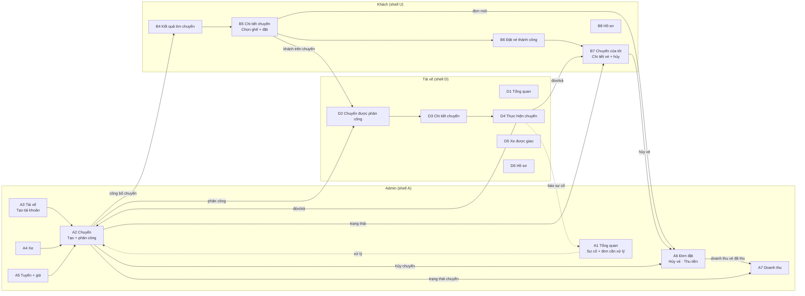
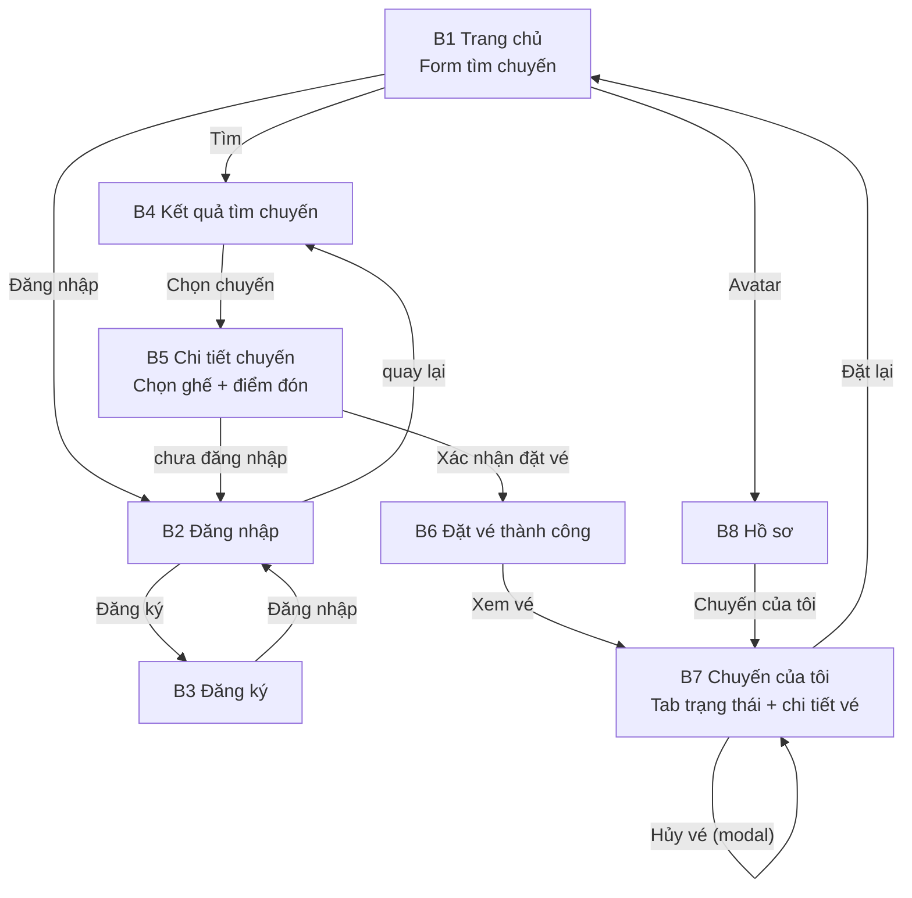
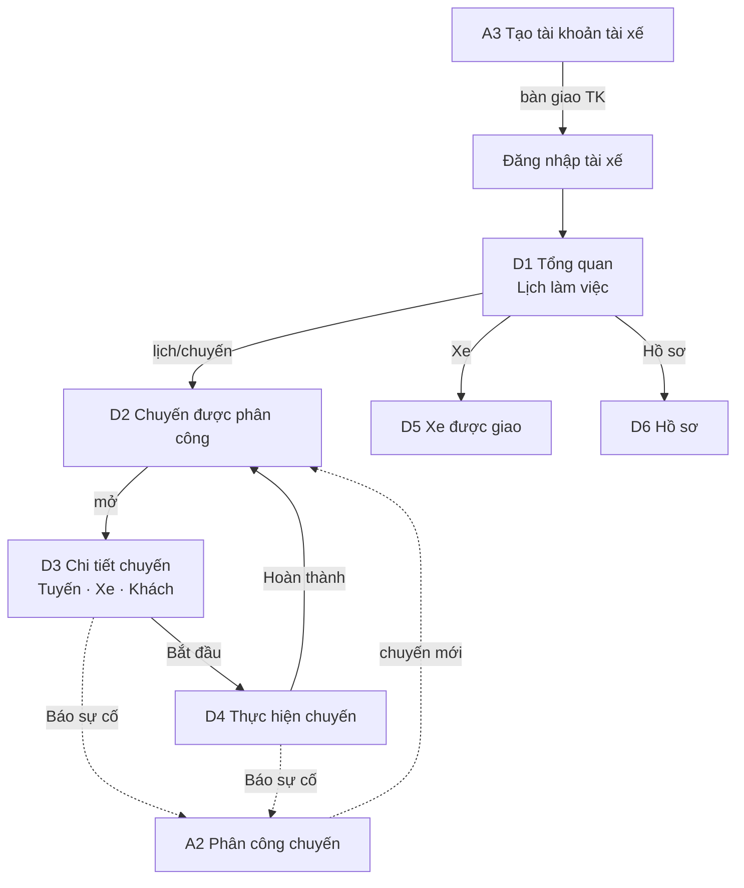
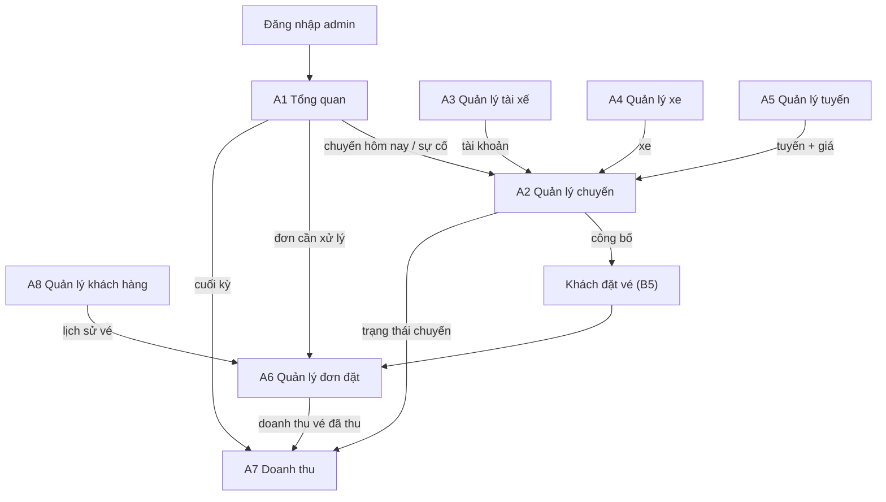

# FLOW APP — Vi Vu Việt (phạm vi tinh gọn)

> Luồng hoạt động của app sau khi tinh gọn cho project cá nhân. Cập nhật ngày
> 2026-10-30, dựa trên source hiện có và phạm vi **22 màn** (8 khách · 6 tài xế ·
> 8 admin).
>
> Nguyên tắc: chỉ giữ nghiệp vụ cốt lõi. Không có trợ giúp/hỗ trợ, ticket,
> chat, FAQ, tổng đài, thông báo, đánh giá, khuyến mãi, CMS, cấu hình, audit
> log, ví/payout.

---

## 1. Bức tranh tổng thể

App gồm **3 web theo vai trò** + tài nguyên chung, cùng một design system:

| Nhóm | Trạng thái | Màn |
|------|------------|-----|
| `khach-hang/` | Đã build 10 file | `index`, `dang-nhap`, `dang-ky`, `ho-so`, `ket-qua-tim-chuyen`, `chi-tiet-chuyen`, `dat-cho-thanh-cong`, `chuyen-cua-toi`, `chuyen-da-dat`, `huy-doi-chuyen` |
| `tai-xe/` | Chưa có màn | Dựng 6 màn D1–D6 |
| `admin/` | Chưa có màn | Dựng 8 màn A1–A8 |
| `shared/` | Dùng chung | 404/500, header, footer, tokens |

- Prototype tĩnh: HTML/CSS/JS thuần, build bằng `node build.js` từ
  `screens/<ten>/screen.json`.
- Không backend; phiên đăng nhập mô phỏng bằng `localStorage`
  (`vvv.auth.user`, `vvv.auth.driver`, `vvv.auth.admin`).
- **Thanh toán MVP:** tiền mặt cho tài xế khi lên xe.

### Chuyển đổi khách hàng về 8 màn

| Hiện có | Sau tinh gọn |
|---------|--------------|
| `index` | B1 Trang chủ — bỏ FAQ/hotline/khối đánh giá/CTA đăng ký tài xế |
| `dang-nhap`, `dang-ky` | B2, B3 |
| `ket-qua-tim-chuyen` | B4 |
| `chi-tiet-chuyen` | B5 |
| `dat-cho-thanh-cong` | B6 |
| `chuyen-cua-toi` | B7 — thêm panel chi tiết vé + nút hủy |
| `chuyen-da-dat` | Gộp vào panel chi tiết vé của B7, bỏ trang riêng |
| `huy-doi-chuyen` | Bỏ; thay bằng modal Hủy vé trong B7 |
| `ho-so` | B8 — bỏ cài đặt thông báo/đánh giá |

---

## 2. Mô hình hoạt động

```
Admin tạo chuyến + gán xe + phân công tài xế        (A2)
        │ công bố chuyến
        ▼
Khách tìm chuyến → chi tiết → chọn ghế → đặt vé      (B4 → B5)
        │ hệ thống tự xác nhận
        ▼
Admin thấy đơn (A6) · Tài xế thấy chuyến (D2)
        │ đến ngày chạy
        ▼
Tài xế bắt đầu, đón/trả khách, thu tiền mặt, hoàn thành (D4)
        │ cập nhật trạng thái vé + chuyến + thanh toán
        ▼
Admin xem doanh thu thực thu (vé đã thu)               (A7, A6)
```

Khác biệt cốt lõi so với bản cũ:

- Tài xế **không tự đăng chuyến**; admin lập lịch và phân công.
- Tài xế **không tự đăng ký**; admin tạo tài khoản ở A3.
- **Không** Online/Offline, không "Nhận chuyến".
- **Không** đổi vé, không đánh giá, không hỗ trợ.

---

## 3. Sơ đồ xuyên vai trò



**Chuỗi rút gọn:**

```
Admin tạo TK tài xế (A3) + xe (A4) + tuyến (A5)
→ Tạo chuyến, gán xe, phân công tài xế (A2)
→ Khách tìm (B4) → đặt vé (B5) → nhận vé (B6)
→ Tài xế thấy chuyến (D2) → xem chi tiết (D3)
→ Chạy chuyến (D4) → cập nhật trạng thái + thu tiền → hoàn thành
→ Admin xem doanh thu thực thu (A7)
```

---

## 4. Luồng khách hàng



**Happy path:**

```
Trang chủ → Kết quả tìm chuyến → Chi tiết chuyến (chọn ghế, điểm đón)
→ Đặt vé thành công → Chuyến của tôi
→ Tài xế đón/trả → vé Hoàn thành
```

**Luồng phụ:**

- Chưa đăng nhập khi đặt → Đăng nhập/Đăng ký → quay lại chi tiết.
- Hủy vé → modal trong chi tiết vé → tab Đã hủy (chỉ khi trước giờ chạy ≥ 12 giờ).
- Admin hủy chuyến → vé Đã hủy, khách thấy lý do.

**Trạng thái vé:** `Đã đặt → Đã đón → Hoàn thành`; nhánh `Không lên xe`, `Đã hủy`.
**Thanh toán:** `Chưa thu → Đã thu` (tiền mặt, tài xế ghi ở D4). Không hoàn tiền.

---

## 5. Luồng tài xế



**Chuỗi rút gọn:**

```
Admin tạo TK (A3) → Tài xế đăng nhập → Tổng quan (D1)
→ Chuyến được phân công (D2) → Chi tiết chuyến (D3)
→ Bắt đầu → Thực hiện chuyến (D4): đón/trả + thu tiền mặt
→ Hoàn thành
Nhánh: Xe được giao (D5), Hồ sơ (D6), Báo sự cố (D3/D4 → A2)
```

**Trạng thái chuyến:** `Sắp tới → Đang thực hiện → Hoàn thành`; nhánh `Đã hủy`
(chỉ khi chuyến chưa bắt đầu).
**Trạng thái khách trên chuyến:** `Chờ đón → Đã đón → Đã trả`; nhánh `Không lên
xe`, `Đã hủy`. Hoàn thành chuyến chỉ khi mọi khách ở trạng thái cuối.
**Thanh toán:** tài xế ghi `Đã thu` cho từng khách đã `Đã đón`; không hoàn tiền.

---

## 6. Luồng admin



**Chuỗi rút gọn:**

```
Đăng nhập → A1
→ A3 tạo TK tài xế · A4 xe · A5 tuyến/giá
→ A2 tạo chuyến + gán xe + phân công → công bố
→ A6 theo dõi đơn, hủy vé
→ A7 doanh thu thực thu, đối soát đơn giản
```

**Thanh toán:** `Chưa thu → Đã thu` (tiền mặt, tài xế ghi ở D4); không có hoàn
tiền.

---

## 7. Điểm nối bắt buộc (chống lệch trạng thái)

1. **Chuyến** do A2 tạo; D2 chỉ đọc chuyến được phân công; B4 chỉ thấy chuyến
   đã công bố.
2. **Vé** do B5 tạo; A6 và B7 đọc cùng trạng thái; D3/D4 cập nhật trạng thái
   khách.
3. **Trạng thái khách** ở D4 (`Chờ đón → Đã đón → Đã trả / Không lên xe`) đồng
   bộ sang trạng thái vé ở B7 và A2/A6.
4. **Trùng lịch**: A2 chặn khi xe/tài xế trùng khoảng thời gian vận hành, hoặc
   số ghế vượt sức chứa, hoặc khách đặt trùng ghế đã có vé.
5. **Hủy chuyến** ở A2 (chỉ khi chưa bắt đầu) → vé liên quan `Đã hủy` → B7 hiển
   thị lý do → A6 ghi nhận; không phát sinh hoàn tiền.
6. **Hủy vé** ở B7 (trong hạn 12 giờ) → A6 thấy đơn đã hủy; vé chưa thu giữ
   `Chưa thu`, không hoàn tiền.
7. **Thu tiền**: tài xế ghi `Đã thu` cho từng khách đã `Đã đón` ở D4; A6/A7 đọc
   cùng trạng thái thanh toán.
8. **Doanh thu**: A7 = tổng tiền thực thu (vé `Đã thu`), không tính vé đặt chưa
   thu hay khách `Không lên xe`.
9. **Tiền công** do A2 nhập; A7 dùng để tính lãi gộp.
10. **Sự cố** do D3/D4 báo → cảnh báo ở A1, xử lý ở A2; tài xế vẫn tiếp tục cập
    nhật; không tự đổi trạng thái chuyến.
11. **Hoàn thành chuyến** chỉ khi mọi vé ở trạng thái cuối, trừ ngoại lệ do admin
    xử lý.
12. **Phiên đăng nhập** tách khóa theo vai trò; cổng đăng nhập tài xế/admin dùng
    chung `dang-nhap` (không tính vào 22 màn).

---

## 8. Hiện trạng & lỗ hổng cần nối

### Khách hàng (đã build)

1. Form tìm chuyến ở trang chủ **chưa** chuyển sang `ket-qua-tim-chuyen.html`;
   đang chỉ hiện status giả sau 950ms.
2. Sau khi đặt vé **chưa tự chuyển** sang `dat-cho-thanh-cong.html`; người dùng
   phải bấm link.
3. Nút trên card "Chuyến của tôi" **chưa có đích** (Chi tiết, Hủy/đổi, Đặt lại).
4. Auth luôn về `index.html`, **chưa nhớ trang trước**.
5. `chuyen-da-dat` và `huy-doi-chuyen` **cần gộp/bỏ** theo phạm vi 8 màn.
6. Trang chủ còn khối **hỗ trợ/FAQ/đánh giá/CTA tài xế** cần bỏ.

### Tài xế & admin

7. `tai-xe/` và `admin/` **chưa có màn**; cần dựng shell D/A và **14 màn**
   (6 tài xế + 8 admin).
8. Chưa có dữ liệu chuyến do admin tạo; D2 phụ thuộc A2.

### Quy tắc nghiệp vụ cần chốt (đã ghi trong 01–03)

10. Tách bạch trạng thái chuyến/vé/thanh toán; vé có nhánh `Không lên xe`.
11. Chặn trùng lịch xe/tài xế, vượt sức chứa, trùng ghế.
12. Bỏ hoàn tiền; khách tự hủy chỉ trước 12 giờ, sau đó admin xử lý.
13. Hoàn thành chuyến chỉ khi mọi khách ở trạng thái cuối (trừ ngoại lệ admin).

### Tài liệu

9. `NAVIGATION.MD` đã cũ; chỉ cập nhật khi người dùng duyệt (file chung).

---

## 9. Kế hoạch nối luồng

| # | Việc | Vai trò | Ưu tiên | Ghi chú |
|---|------|---------|---------|---------|
| 1 | Nối form trang chủ → `ket-qua-tim-chuyen` | Khách | P0 | §8.1 |
| 2 | Tự chuyển sang `dat-cho-thanh-cong` sau đặt | Khách | P0 | §8.2 |
| 3 | Nối card "Chuyến của tôi" + panel chi tiết vé | Khách | P0 | §8.3 |
| 4 | Auth quay về trang trước | Khách | P1 | §8.4 |
| 5 | Gộp `chuyen-da-dat` vào B7, bỏ `huy-doi-chuyen` | Khách | P0 | §1 |
| 6 | Dựng shell D + D1–D4, D6 | Tài xế | P1 | 02 |
| 7 | Dựng shell A + A3, A4, A5 → A2 → A1, A6 | Admin | P1 | 03 |
| 8 | Dựng D5 và A7, A8 | TX + Admin | P2 | 02, 03 |
| 9 | Rà bỏ toàn bộ khối hỗ trợ/FAQ/hotline/chuông | Cả 3 | P0 | 00 §9 |
| 10 | Đồng bộ `NAVIGATION.MD` | Chung | P2 | file chung, chỉ sửa khi được duyệt |
| 11 | Chặn trùng lịch xe/tài xế, vượt sức chứa, trùng ghế | Admin + Khách | P0 | §7.4 |
| 12 | Ánh xạ trạng thái khách→vé, thêm `Không lên xe` | Cả 3 | P0 | §7.3 |
| 13 | Tài xế ghi `Đã thu` từng vé ở D4; A7 tính doanh thu thực thu | TX + Admin | P0 | §7.7–7.8 |
| 14 | Chốt quy tắc hủy (12 giờ, chưa bắt đầu); bỏ hoàn tiền | Cả 3 | P0 | 01 §4, 03 §4 |

> Quy ước khi thêm màn: tạo `screens/<ten>/screen.json`, chạy `node build.js`,
> không sửa file build tay; tuân `DESIGN_RULES.MD`.